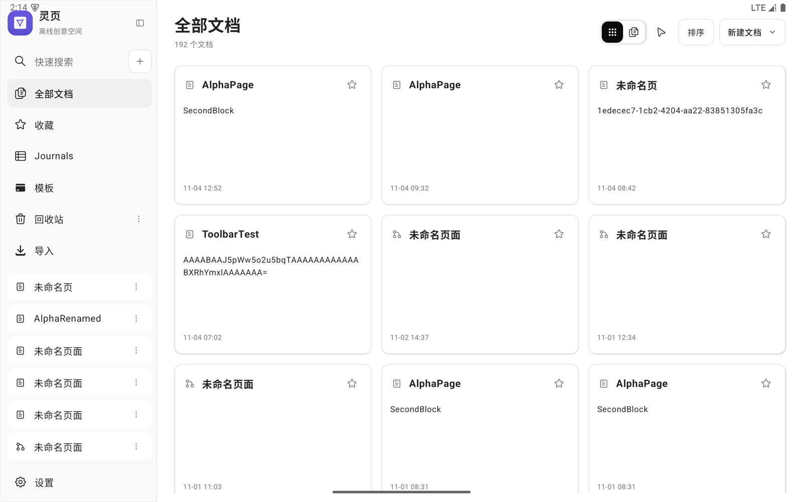
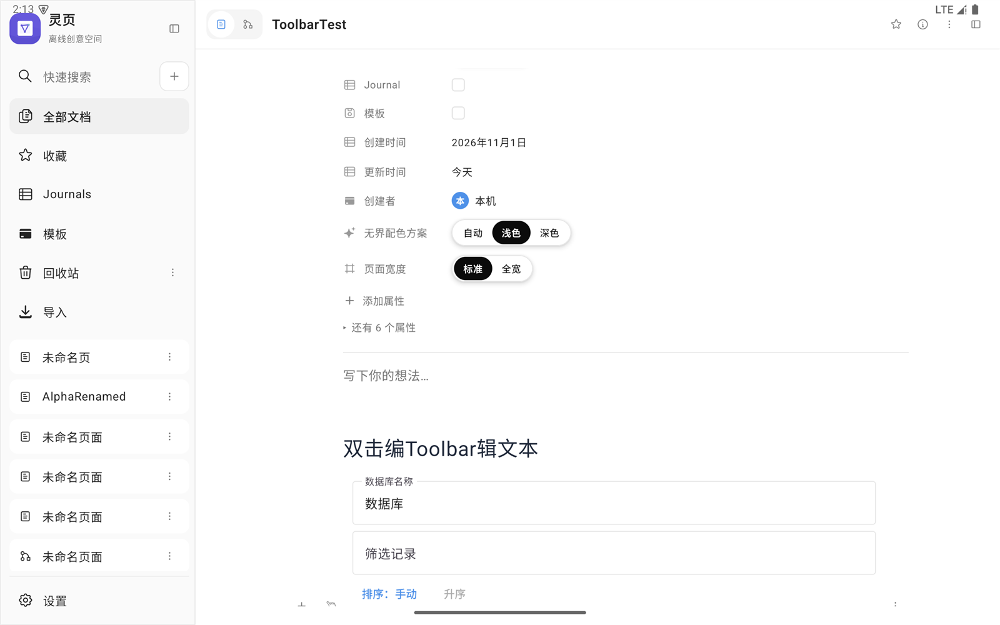
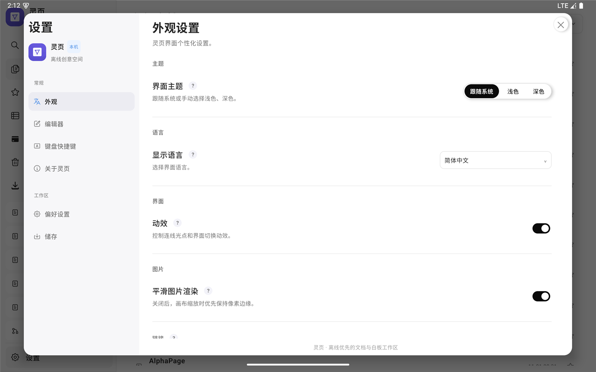

# 灵页（Lingye）

面向 Android 平板的**离线文档 + 无界白板**应用。使用 Kotlin 与 Jetpack Compose 开发，所有页面、图片、历史与备份默认保存在本机，不依赖账号或云服务。

<p>
  
  
  
</p>

> 当前为 **0.15 开发版**，页面格式 **25**。开发版不应作为唯一资料存储，升级/卸载前请先导出备份。

## 项目状态

| 项目 | 状态 |
|---|---|
| 平台 | Android 8.0+（`minSdk 26`，`targetSdk 36`） |
| 语言/UI | Kotlin、Jetpack Compose、单 Activity |
| 页面格式 | 25（含多文件夹、Tags、收藏、连线端点/文字、emoji 图标、图形字体与字符级格式） |
| 数据存储 | 应用私有目录 + `AtomicFile`；页面写入走单线程队列 |
| 备份格式 | `lingye-backup-2`（可选 `metadata.dat`，兼容 `lingye-backup-1`） |
| 测试 | 434 项 JVM 单元测试，0 失败 |
| 发布 | R8 + Release APK，已在 Android 15 平板模拟器冒烟 |

## 功能概览

### 文档

- 段落、H1–H6、待办、项目符号、编号、引用、代码、分隔线、图片、数据库、共享块。
- 块拖拽重排、斜杠菜单、块级字体/粗体/斜体/下划线、Markdown 导入导出。
- 数据库：文本/多行/数字/复选/日期字段，表格、看板、列表、日历视图，排序与筛选。
- 页面：图标、标签、多文件夹、收藏、回收站、双向链接、搜索、标签页。
- Journal 与模板：Journal 关联日期并进入周历；模板页可复用为副本。
- 共享块：跨页面引用，支持共享撤销/重做与图片替换。

### 白板

- 平移/缩放、圆点网格、手形/选择/框选、网格吸附与智能参考线。
- 画笔/高亮笔/橡皮（整笔或区域）、手写笔优先。
- 矩形/圆角矩形/圆形/直线、文本框、图片、卡片/笔记、思维导图、Frame。
- 连线：曲线/直线、圆点/箭头/三角/菱形/无端点、文字标签、光点动效、端口吸附。
- 多选、组合、对齐、图层、锁定、复制、选区模板。
- Frame：重命名、背景色、导航、演示模式、几何包含成员；不支持持久化嵌套关系。
- 模板画廊：AFFiNE 官方分类图片模板与本地卡片预设。

### 界面与输入

- AFFiNE 风格侧栏、顶栏、浮动工具条与参数条；浅色/深色主题。
- 响应式：360dp、540dp、640dp、1280dp 与真实分屏；200% 系统字体复核。
- 键盘快捷键：工具键、撤销/重做、全选、删除、方向键微移、缩放；文档 Ctrl+B/I/U 与标题切换。
- 所有图片颜色入口共用取色器；菜单统一 `MenuRow` 样式。

## 明确限制与未验证项

| 能力 | 状态 |
|---|---|
| 设备级“导出 → 清空 → 恢复” | ⚠️ 未执行；仅验证 ZIP 编解码、旧格式兼容与 ID 重映射（U-PROJ-022） |
| 真实手写笔/压感/手掌误触 | ⚠️ 仅模拟器模拟手写笔，未真机验证 |
| 画布图片解码/裁剪交互 | ⚠️ 多批只做编译与页面/白板冒烟，未插入新图片做交互验证 |
| 性能基线 | ⚠️ 无同条件前后对比；列表滚动仍有卡顿，未达 5% 严格目标 |
| Frame 持久化父子关系、嵌套演示顺序 | ❌ 未实现 |
| 思维导图拖拽改接、主题、节点折叠 | ❌ 未实现 |
| 模板画廊可编辑矢量模板 | ❌ 官方模板以图片对象插入 |
| 实时协作/云同步 | ❌ 不提供 |
| SVG / TIFF / PSD 导入 | ❌ 无平台解码器 |
| 快捷键自定义、新建文档 Ask 模式 | ❌ 未实现 |
| Gradle 多模块、ViewModel、DI | ⚠️ 仅完成包边界，尚未拆模块 |

页面格式 25 可读取旧版页面，但**旧版应用不能读取格式 25**。卸载应用可能删除本地数据，请先导出备份并保留其他副本。

## 仓库结构

```text
.
├── README.md                     # 本文件
├── docs/                         # 早期设计规格与路线图
├── tablet-workspace/             # Android 应用
│   ├── app/src/main/             # Kotlin 源码与资源
│   ├── app/src/test/             # JVM 单元测试（434 项）
│   ├── docs/design/              # 视觉升级、白板/卡片设计草案
│   ├── docs/affine-audit/        # 架构、数据安全、UI 迭代、问题导览
│   ├── docs/edgeless-audit/      # 白板对象与交互审计
│   ├── releases/                 # 当前 Release APK
│   ├── README.md                 # 功能细节与构建说明（主文档）
│   ├── build.gradle.kts
│   └── settings.gradle.kts
└── .gitignore
```

## 安装

1. 打开 [Releases](https://github.com/xyl-kong/lingye/releases) 页面，下载最新的 `lingye-v0.15-...-release-*.apk`。
2. 在平板的“设置 → 应用 → 特殊应用权限 → 安装未知应用”中，允许浏览器或文件管理器安装 APK。
3. 打开下载的 APK 完成安装。首次启动会创建本地工作区，不需要账号或网络。
4. 可选校验：`SHA-256` 应与 Release 说明一致。当前版本为 `E47897F7826A0E5C5977F2790856C8B67D083169FA03BBF09797AA0C232F8CD9`。

> 开发版可能与旧版本数据不兼容：升级前请先在“设置 → 储存/备份”导出备份；不要把它作为唯一资料存储。

## 构建

需要 **JDK 21**、**Android SDK 36** 与 **Gradle 8.13**。仓库未包含 Gradle Wrapper；`local.properties` 与调试签名不入库。

```bash
export JAVA_HOME=/path/to/jdk-21
cd tablet-workspace
gradle testDebugUnitTest assembleRelease
```

Windows 下若项目路径包含中文，建议先镜像到英文路径再构建：

```powershell
$env:JAVA_HOME = "D:\apply\andriod\android-1\jbr"
robocopy "tablet-workspace\app\src" "<英文副本>\app\src" /MIR
gradle.bat -p "<英文副本>" testDebugUnitTest assembleRelease
```

Release 启用 R8（`app/proguard-rules.pro`）。调试签名可用项目根目录的 `debug.keystore` 生成；不要把 `local.properties`、签名文件或本机备份提交到仓库。

## 当前发布

- 文件：`tablet-workspace/releases/lingye-v0.15-architecture-batch34-release-20261104.apk`
- 大小：3,440,431 字节
- SHA-256：`E47897F7826A0E5C5977F2790856C8B67D083169FA03BBF09797AA0C232F8CD9`

历史版本的哈希保留在审计文档中；仓库只保留最新 APK。

## 文档索引

- [功能细节与构建说明](tablet-workspace/README.md)
- [开发全流程、主要问题与限制](tablet-workspace/docs/affine-audit/DEVELOPMENT_SUMMARY_20261104.md)
- [UI 设计逐轮修改记录](tablet-workspace/docs/affine-audit/UI_DESIGN_ITERATIONS.md)
- [问题频率、根源与复发风险（可视化）](tablet-workspace/docs/affine-audit/problem-navigation.html)
- [架构审计与 batch1–34 记录](tablet-workspace/docs/affine-audit/ARCHITECTURE_AUDIT_20261103.md)
- [数据安全索引](tablet-workspace/docs/affine-audit/DATA_SAFETY_INDEX.md)
- [页面格式 25 说明](tablet-workspace/docs/affine-audit/PAGE_FORMAT_25.md)
- [P2 模块化计划](tablet-workspace/docs/affine-audit/P2_MODULE_PLAN.md)

## 许可证

仓库目前未附开源许可证。在复制、分发或商用前，请先与仓库所有者确认授权方式。
